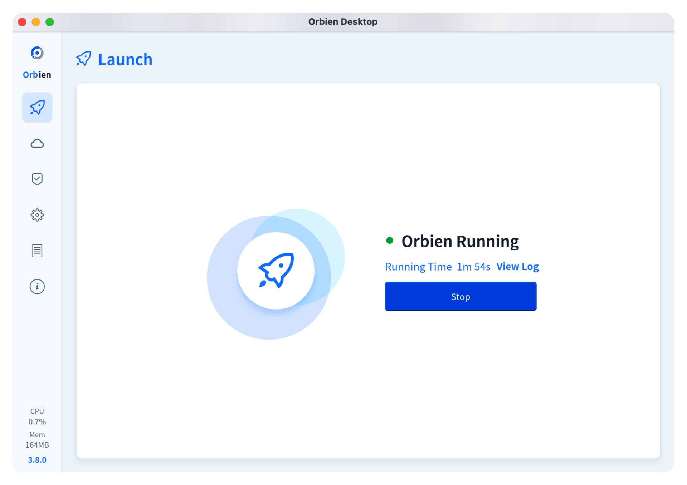

# Orbien

<div align="center">
  
</div>

<p align="center" style="font-size:18px;color:#555;margin-top:-10px;margin-bottom:24px;">
Expose a service behind NAT or a firewall without giving up control of the wire.
</p>

<div align="center">
  <a href="https://github.com/orbien-org/orbien/stargazers"></a>
  <a href="https://github.com/orbien-org/orbien/forks"></a>
  <a href="https://github.com/orbien-org/orbien/issues"></a>
  <a href="https://github.com/orbien-org/orbien/blob/main/LICENSE"></a>
  <a href="https://www.rust-lang.org/"></a>
  <a href="https://github.com/orbien-org/orbien/releases"></a>
  <a href="https://discord.gg/4dgQjCS3k"></a>
</div>

<div align="center">
  <a href="README.md"><strong>English</strong></a> &nbsp;|&nbsp;
  <a href="README_ZH.md"><strong>简体中文</strong></a>
  &nbsp;|&nbsp;
  <a href="https://orbien-org.github.io/orbien/"><strong>Documentation</strong></a>
</div>


Orbien is a reverse tunnel. A small agent on your machine keeps an outbound
connection to a server you own, and the server publishes the ports and hosts you
asked for. TCP, UDP, HTTP(S) and SOCKS5 backends all ride the same control
plane. The release binary is around 5 MB and idles at a few megabytes of RSS.

## What it does

| | |
|---|---|
| **Tunnel protocols** | `tcp`, `udp`, `http`, `https`, `socks5` |
| **Transports** | TCP, KCP, WebSocket, QUIC, with optional yamux multiplexing |
| **Auth** | HMAC-SHA256 pre-shared token, replay window, TLS / mTLS |
| **HTTP edge** | virtual hosts, path routing, PROXY protocol, `X-Forwarded-For`, basic auth, header rewrite |
| **Ops** | web dashboard, native desktop client, config hot-reload, ACME issuance |

The HTTP and HTTPS listeners do not terminate anything by default: TLS is
forwarded byte for byte unless you put the client into TLS-termination mode.
Handy when the origin already speaks TLS and you would rather not hand out its
key.

## Quick start

Grab a release archive, or build from source (see below).

```toml
# orbien-server.toml
listen = "0.0.0.0:9527"
auth.token = "change-me"
```

```shell
./orbien-server -c orbien-server.toml
```

```toml
# orbien.toml
server = "example.com:9527"

[auth]
token = "change-me"

[[tunnels]]
name = "ssh"
protocol = "tcp"
service = "127.0.0.1:22"
remotePort = 9000
```

```shell
./orbien -c orbien.toml
ssh -p 9000 user@example.com
```

Prefer clicking to typing? [Orbien-Desktop](https://github.com/orbien-org/orbien/releases)
runs the same client in-process.



## Inside

Five crates, one protocol contract:

```
proto/     orbien-proto    no_std + alloc: message contracts, framing, HMAC
core/      orbien-core     tokio: transports, TLS, config, limits
client/    orbien-client   agent, connector, tunnel plugins, control socket
server/    orbien-server   control sessions, tunnel registry, dashboard
desktop/   orbien-desktop  Slint UI, in-process client, ACME
```

### The protocol crate is `no_std`

`orbien-proto` has no sockets, no clock and no async runtime. It knows how to
turn a `Message` into bytes and back, and nothing else. That keeps the wire
contract buildable for an embedded agent or a WASM client, and it means the
protocol is testable without a runtime. Everything that touches the network
lives one crate up.

### Two codecs, one frame

```
tag(1)   length(4, LE)   body
```

`tag` is a message type byte (`'A'`, `'T'`, `'D'`, …). Bit 7 selects the body
encoding:

* **clear** — JSON, written and read by [`nextjson`](https://crates.io/crates/nextjson).
  Every message type carries a `nextjson` schema, so the contract is a value you
  can diff between versions instead of documentation that drifts.
* **set** — the compact schema-guided profile of
  [`rustbinary`](https://crates.io/crates/rustbinary). No tags, no field names,
  varint integers, length-prefixed containers, with byte and collection ceilings
  enforced before allocation.

The switch happens once per connection. `Login` is always JSON; the server
answers with `codec: "binary"` in `LoginResp`, and from there both sides use the
compact profile. A peer that ignores the field — the Java client, an older
agent — keeps exchanging JSON and never notices. No negotiation round trip, no
flag day.

The difference is not cosmetic. A `NewTunnel` for one TCP tunnel is 289 bytes as
JSON and 54 bytes in the compact profile; a `UdpPacket` carries the datagram as
raw bytes instead of base64.

### DNS is ours

Hostname resolution goes through [`recurse-x`](https://crates.io/crates/recurse-x)
instead of handing the question straight to the platform stub resolver. It uses
the platform's own nameservers as upstreams — because plenty of networks drop
UDP/53 to the roots — and keeps a cache, retry budget and response validation in
front of them. With no upstream configured it walks the delegation from the
root. If the recursive path yields nothing, the system stub resolver is the last
resort, so a locked-down network degrades instead of refusing to start.

Literal addresses and `localhost` never touch the network.

### WebSocket and the dashboard run on `courierust`

* The WebSocket transport uses [`courierust`](https://crates.io/crates/courierust)'s
  `courierust_ws` frame codec and handshake — RFC 6455 framing, masking, control
  frames, the close handshake — over tokio sockets. One task per direction, not
  one thread per connection.
* The dashboard is served by `courierust_server` on its own scheduler. It is
  low-traffic and independent of the data plane, so a separate concurrency model
  costs nothing and keeps routing out of the hot path.

The tunnel data plane stays on tokio: `tokio-rustls` for TLS, `quinn` for QUIC.
Those layers are async down to the syscall, and a thread-per-connection wrapper
would not survive a benchmark. `courierust`'s TLS and QUIC stacks are
synchronous — using them here would trade the memory profile this project is
built for against a code-sharing checkbox. Protocol cores are shared; blocking
transports are not.

### TLS and multiplexing

With `transport.tcpMux = true` (the default) every tunnel stream is a yamux
stream over one physical connection, so a hundred tunnels cost one TCP
handshake. QUIC skips yamux because its streams are already multiplexed. KCP is
there for lossy links where TCP's congestion response is the wrong answer.

TLS is optional and configured per side. Self-signed certificates are generated
on first start; mTLS verifies client certificates against a CA you supply.

## Configuration

`conf/orbien.toml` and `conf/orbien-server.toml` are the minimal examples.
`conf/orbien-full.toml` and `conf/orbien-server-full.toml` list every field with
its default. `${VAR}` placeholders are expanded at load time.

Hot reload covers tunnels, bandwidth limits and logging. Changing the listen
address, the transport or the TLS material reconnects the control channel; the
agent reports which level it took in the reload outcome.

## Build

```shell
cargo build --release -p orbien-server -p orbien-client
```

The dashboard bundle is a separate build:

```shell
npm --prefix server-ui ci
npm --prefix server-ui run build   # writes into server/assets/
cargo build --release -p orbien-server
```

`server/assets/` is gitignored. A Rust-only checkout still compiles: `build.rs`
drops a placeholder page there so `rust-embed` has something to embed, and the
UI build replaces the whole directory.

## Benchmarks

| | |
|---|---|
| Platform | macOS 26.2 · Darwin 25.2.0 · arm64 |
| Hardware | Apple M2 (8 cores) · 16 GB |
| Details | [orbien-org/benchmarks](https://github.com/orbien-org/benchmarks) |

Loopback, to keep the network out of the picture. Against `frp` the useful
difference is not peak throughput — it is that memory stays flat as concurrency
climbs.


## License

Apache-2.0. See [LICENSE](LICENSE).

## Contact

Issues: [orbien-org/orbien/issues](https://github.com/orbien-org/orbien/issues) ·
Discord: [discord.gg/4dgQjCS3k](https://discord.com/invite/4dgQjCS3k)
