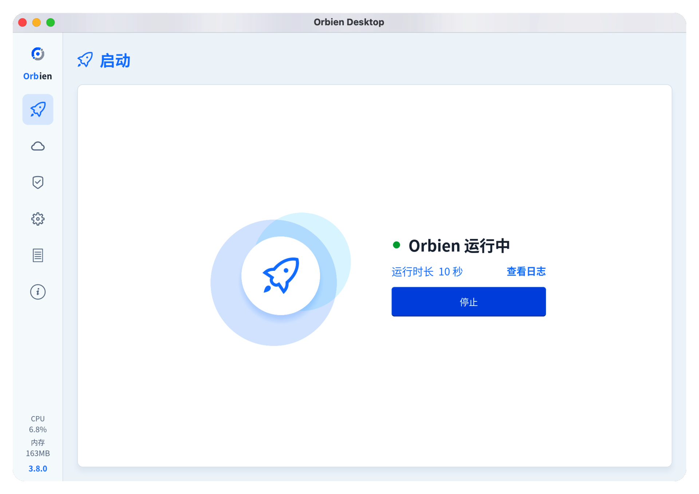

# Orbien

<div align="center">
  
</div>

<p align="center" style="font-size:18px;color:#555;margin-top:-10px;margin-bottom:24px;">
内网穿透，但线路握在自己手里。
</p>

<div align="center">
  <a href="https://github.com/orbien-org/orbien/stargazers"></a>
  <a href="https://github.com/orbien-org/orbien/forks"></a>
  <a href="https://github.com/orbien-org/orbien/issues"></a>
  <a href="https://github.com/orbien-org/orbien/blob/main/LICENSE"></a>
  <a href="https://www.rust-lang.org/"></a>
  <a href="https://github.com/orbien-org/orbien/releases"></a>
  <a href="https://discord.gg/4dgQjCS3k"></a>
</div>

<div align="center">
  <a href="README.md"><strong>English</strong></a> &nbsp;|&nbsp;
  <a href="README_ZH.md"><strong>简体中文</strong></a>
  &nbsp;|&nbsp;
  <a href="https://orbien-org.github.io/orbien/"><strong>文档</strong></a>
</div>


Orbien 干的事很单一：内网机器上的 agent 主动连到你自己的一台服务器，服务器把你
指定的端口和域名放出去。TCP、UDP、HTTP(S)、SOCKS5 后端共用同一套控制面。release
二进制 5 MB 左右，空闲常驻内存只有几 MB。

## 能力

| | |
|---|---|
| **隧道协议** | `tcp`、`udp`、`http`、`https`、`socks5` |
| **传输层** | TCP、KCP、WebSocket、QUIC，可选 yamux 多路复用 |
| **鉴权** | HMAC-SHA256 预共享 token、重放窗口、TLS / mTLS |
| **HTTP 入口** | 虚拟主机、路径路由、PROXY protocol、`X-Forwarded-For`、Basic Auth、Header 改写 |
| **运维** | Web 控制台、原生桌面端、配置热重载、ACME 自动签发 |

HTTP / HTTPS 监听默认不做 TLS 终止，而是按字节透传；需要时可以让客户端做 TLS 终止。
源站自己就是 HTTPS、又不想把私钥交出去的时候，这个模式省事。

## 快速开始

下载 release 包，或者自己编译（见下文）。

```toml
# orbien-server.toml
listen = "0.0.0.0:9527"
auth.token = "change-me"
```

```shell
./orbien-server -c orbien-server.toml
```

```toml
# orbien.toml
server = "example.com:9527"

[auth]
token = "change-me"

[[tunnels]]
name = "ssh"
protocol = "tcp"
service = "127.0.0.1:22"
remotePort = 9000
```

```shell
./orbien -c orbien.toml
ssh -p 9000 user@example.com
```

不想敲命令就用 [Orbien-Desktop](https://github.com/orbien-org/orbien/releases)，
它把同一个客户端进程内嵌进了 GUI。



## 实现

五个 crate，一份协议契约：

```
proto/     orbien-proto    no_std + alloc：消息契约、分帧、HMAC
core/      orbien-core     tokio：传输层、TLS、配置、限速
client/    orbien-client   agent、连接器、隧道插件、本地控制通道
server/    orbien-server   控制会话、隧道注册表、控制台
desktop/   orbien-desktop  Slint UI、进程内客户端、ACME
```

### 协议 crate 是 `no_std` 的

`orbien-proto` 没有 socket、没有时钟、没有异步运行时。它只负责把 `Message` 变成
字节再变回来。这样这套线协议可以被嵌入式 agent 或 WASM 客户端直接复用，也意味着
协议本身不启动运行时就能测。所有需要联网的东西都在上一层。

### 两种编码，同一套帧

```
tag(1)   length(4, LE)   body
```

`tag` 是消息类型字节（`'A'`、`'T'`、`'D'` …），最高位选 body 的编码：

* **不置位** —— JSON，由 [`nextjson`](https://crates.io/crates/nextjson) 读写。
  每个消息类型都带一份 `nextjson` schema，契约因此是可以逐版本 diff 的值，而不是
  会过期的文档。
* **置位** —— [`rustbinary`](https://crates.io/crates/rustbinary) 的 compact
  schema 模式。无 tag、无字段名、varint 整数、长度前缀容器，分配之前先过字节和
  集合两道上限。

切换只发生在建连时。`Login` 永远是 JSON；服务端在 `LoginResp` 里回 `codec: "binary"`，
之后双方走 compact。忽略这个字段的对端——Java 客户端、旧版 agent——继续用 JSON，
完全无感。没有多一次协商往返，也不需要统一割接。

省下来的是实打实的字节：一条单 TCP 隧道的 `NewTunnel`，JSON 是 289 字节，compact
是 54 字节；`UdpPacket` 直接装原始字节，不再套 base64。

### DNS 自己做

域名解析走 [`recurse-x`](https://crates.io/crates/recurse-x)，而不是直接把问题丢给
系统 stub resolver。它把平台配置的 nameserver 当作 upstream——很多网络会直接丢弃
发往根服务器的 UDP/53——同时保留自己的缓存、重试预算和应答校验；没有 upstream 时
从根开始迭代。递归这条路拿不到结果，才退回系统解析器，受限网络下是降级而不是起不来。

IP 字面量和 `localhost` 不进网络。

### WebSocket 与控制台用 `courierust`

* WebSocket 传输用 [`courierust`](https://crates.io/crates/courierust) 的
  `courierust_ws` 做帧编解码和握手——RFC 6455 分帧、掩码、控制帧、关闭握手——
  底下仍然是 tokio socket。每个方向一个 task，不是每条连接一个线程。
* 控制台交给 `courierust_server`，跑在它自己的调度器上。控制台流量很小、跟数据面
  完全隔离，换个并发模型没有代价，还能让热路径里少一层路由。

隧道数据面留在 tokio：TLS 用 `tokio-rustls`，QUIC 用 `quinn`。这两层从调用到
syscall 都是异步的；套一层 thread-per-connection 过不了压测。`courierust` 的
TLS / QUIC 实现是同步的，硬换过来等于拿这个项目赖以立足的内存曲线去换一个"统一
依赖"的勾。共享协议核心，不共享阻塞传输。

### TLS 与多路复用

`transport.tcpMux = true`（默认）时，每条隧道流是同一根物理连接上的 yamux stream，
一百条隧道只付一次 TCP 握手。QUIC 不用 yamux，它的 stream 本身已经多路复用。KCP
留给丢包严重、TCP 拥塞反应明显不对的链路。

TLS 可选，按端配置。首次启动自动生成自签证书；mTLS 用你提供的 CA 校验客户端证书。

## 配置

`conf/orbien.toml` 和 `conf/orbien-server.toml` 是最小示例，
`conf/orbien-full.toml` 和 `conf/orbien-server-full.toml` 列了所有字段及其默认值。
`${VAR}` 占位符在加载时展开。

热重载覆盖隧道、限速和日志。改监听地址、传输层或 TLS 材料会重连控制通道，agent
会在 reload 结果里报告实际走到了哪一级。

## 编译

```shell
cargo build --release -p orbien-server -p orbien-client
```

控制台前端单独构建：

```shell
npm --prefix server-ui ci
npm --prefix server-ui run build   # 输出到 server/assets/
cargo build --release -p orbien-server
```

`server/assets/` 不进版本库。只改 Rust 的检出也能编过：`build.rs` 会先放一个占位页
让 `rust-embed` 有东西可嵌，前端一构建就会整个目录覆盖掉。

## 性能

| | |
|---|---|
| 平台 | macOS 26.2 · Darwin 25.2.0 · arm64 |
| 硬件 | Apple M2（8 核）· 16 GB |
| 明细 | [orbien-org/benchmarks](https://github.com/orbien-org/benchmarks) |

跑的是本地回环，把网络因素摘出去。和 `frp` 比，真正有价值的差别不是峰值吞吐，
而是并发拉高之后内存依然是一条平线。


## 许可证

Apache-2.0，见 [LICENSE](LICENSE)。

## 联系

问题反馈：[orbien-org/orbien/issues](https://github.com/orbien-org/orbien/issues) ·
Discord：[discord.gg/4dgQjCS3k](https://discord.com/invite/4dgQjCS3k)
